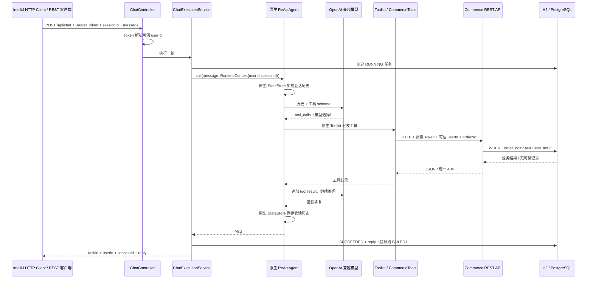

# P0 系统架构与执行链路

本轮最终范围：Windows 主机上的独立 Agent 服务，默认 H2，保留 PostgreSQL 切换。Chatwoot 暂缓，不要求安装 Docker。

## 模块边界

单个 Spring Boot 进程包含 Agent 与模拟售后业务包，以降低 P0 运行成本；Agent 的业务工具仍通过实际 HTTP API 调用业务模块，没有调用业务 Repository 或 JdbcTemplate。`COMMERCE_BASE_URL` 可指向未来独立部署的业务 API，本轮不拆分微服务。

数据表：`commerce_orders`、`commerce_logistics`、`agent_tasks`。使用相同 Flyway SQL 初始化 H2 或 PostgreSQL。H2 兼容模式已测试；真实 PostgreSQL 的兼容性需通过显式 `postgres-it` 验证。

## 用户与会话

HTTP 层将两个演示 Token 映射为 alice/bob，服务层给 session 加 `debug:` 命名空间，然后通过 `RuntimeContext` 传递。`userId` 和 `sessionId` 共同标识状态，身份不从用户文本或模型参数中提取。工具 schema 只暴露 `orderNo`，`RuntimeContext` 参数由 AgentScope 自动注入。

AgentScope 2.0.4 原生支持基于 `(userId, sessionId)` 的状态加载保存和同会话调用串行化。本项目使用 `InMemoryAgentStateStore`，没有自行管理对话消息数组或实现 session 锁。[官方 v2.0.4 Agent 文档](https://github.com/agentscope-ai/agentscope-java/blob/v2.0.4/docs/v2/en/docs/building-blocks/agent.md)、[工具参数注入文档](https://github.com/agentscope-ai/agentscope-java/blob/v2.0.4/docs/v2/en/docs/building-blocks/tool.md)。

## 业务访问控制

用户直查 API 使用 Bearer Token；工具使用独立 `X-Service-Token` 携带服务端注入的 `X-User-Id`。业务服务在两条路径均取得已验证身份，再执行带用户归属条件的 SQL。未提供服务 Token 时，单独伪造 `X-User-Id` 无效；提供错误服务 Token 则认证失败。

越权订单和未知订单都返回相同 `404 ORDER_NOT_FOUND` 和相同文案。不会先按订单号查询后再把他人订单数据送给模型。

## 基础任务状态与错误

每个合法且已认证的对话请求创建一个任务，状态为 `RUNNING → SUCCEEDED / FAILED`。列表与详情按当前用户查询。任务与回复持久化，模型上下文在内存中；二者生命周期不同。

原生循环 `maxIters=6`，上限由 AgentScope 执行；本项目检查最终 `GenerateReason`，只将 `MODEL_STOP` 视为正常回复。框架的上限总结不被记录为成功。总超时取消当前订阅并返回 504；底层 HTTP 业务查询连接超时 3 秒、读取超时 5 秒。此机制不等同于分布式取消、事务补偿或任务恢复。

工具查询不可用时反馈 `COMMERCE_UNAVAILABLE`，提示模型说明查询失败。订单不存在是可正常回答的业务结果，任务可为 SUCCEEDED；模型报错、超时及循环上限是执行失败。

## 可观测性与测试证据等级

- 模型原生 `onModelCall` middleware：用户、会话、耗时、结束信号、错误类型。
- 工具日志：名称、可信用户、会话、耗时和查询结果类别。
- 任务日志/表：taskId、会话和最终状态；任务表保存回复或错误码。
- 日志不记录 API Key、完整用户提示、模型思考链或业务响应全文。

Fake OpenAI 测试通过真实 HTTP 返回预设 tool_calls，让真实 ReActAgent 执行工具并续接结果。这是协议与执行链的直接验证；工具选择规则来自测试代码，因此不能据此声称真实模型已具备自主决策能力。

2026-10-16 另行完成真实 DeepSeek `deepseek-chat` 六次对话联调，实际模型分别选择订单/物流工具，并在同一会话中沿用 RF1003；越权与未知订单返回统一不可查询语义。逐场景事实和调用日志已核对，见 `docs/verification.md` 及 `output/20261016_真实模型联调_v01/20261016_真实模型联调总结_v01.md`。
