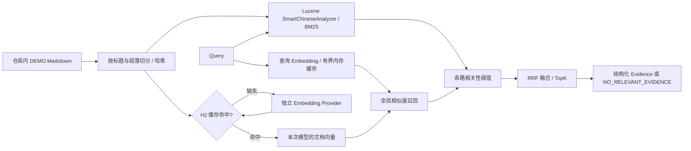

# P1 Hybrid RAG 设计与源码索引

P1 从 `codex/p0` 的 `cf4d10ac4d2c2f4bf5e76e9564dd24f074a44b76` 开始，保留 Java 21、Spring Boot 4.0.4、AgentScope Java 2.0.4、H2 和原生 ReActAgent Loop。

## 执行链

`searchPolicy` 是原生 Toolkit 的第三个工具，与 `queryOrder`、`queryLogistics` 并列。模型决定是否以及如何组合调用，生产代码没有关键词意图路由、固定工具调用顺序或自实现 Agent Loop。

## 知识文档与切分

`src/main/resources/knowledge/` 包含退款、退换货、发货、物流异常、签收五份演示政策。所有文件必须标记 `kind: DEMO`，不会冒充真实平台规则。公共政策不保存具体用户订单、订单归属或商品金额；订单事实仍必须查询业务工具。

每份 Markdown 的 frontmatter 包含 `sourceId`、`version`、`effectiveDate` 和 `kind`；二级标题使用显式锚点，例如 `## 已支付未发货退款 {#unshipped}`。加载器按标题分段，同一段落不跨条款，超过 700 字符时在段落边界分组，超长单段要求维护者拆分。稳定 Chunk ID 为 `DEMO-REFUND#unshipped-p1`，后缀对应段落组。

Chunk 保留 `sourceId / chunkId / title / content / version / effectiveDate / documentHash / contentHash`。文档哈希包含规范化后的全文与元数据；内容哈希针对实际 Embedding 输入（标题与正文）。只改版本元数据时更新文档哈希，复用相同内容向量；正文或标题改变时生成新向量。新增、删除和重排文档后，本次检索只加载当前语料，不会返回已经移除的旧缓存条款。

## 索引与缓存

- Lucene 10.3.2 使用内存 ByteBuffersDirectory、SmartChineseAnalyzer 和 BM25Similarity。重启时重建这份很小的倒排索引，不调用模型。查询由分词后的 TermQuery 构成，不将用户输入当作 Lucene 查询语法。标题权重为 1.7。
- 向量使用独立 `EmbeddingProvider`。生产实现请求 `${EMBEDDING_BASE_URL}/embeddings`，传入 model、dimensions 和 `encoding_format=float`；每批不超过 10 条。按返回 index 恢复顺序，校验条数、维度、数字、有限值、非零范数及返回模型名。
- H2 `policy_embedding_cache`（V4 迁移）存储 provider identity、model、dimensions、chunkId、documentHash、contentHash 和向量 JSON。缓存键是服务身份、Chunk ID 和内容哈希的 SHA-256；服务身份包含 base URL、模型和维度，不包含 API Key。
- 内容改变只重算受影响 Chunk；模型、维度或服务地址改变后不会命中旧向量。轮换同一服务的密钥不会无意义地重建向量。损坏缓存经过校验后重新生成，不用零向量填充。历史缓存留在 H2 中，不自动删除数据。
- 查询向量使用至多 256 项的进程内 LRU，键为服务身份与查询哈希；不持久化私有查询文本。Vector/Hybrid 对比可复用相同查询向量。

本轮不引入向量数据库、文档上传、通用知识管理、定时同步或复杂异步索引。修改仓库内 Markdown 后重启即可重复执行加载与增量向量缓存流程。

## 相关性、融合与降级

默认值：TopK=5、各路 RecallK=12、BM25 最低原始分数 1.2、查询词覆盖率 0.35、余弦最低相似度 0.60、RRF K=60、最低融合分数 0。

词法覆盖率是候选标题/正文包含的去重查询 token 数除以查询 token 总数。各路先过滤，再按排名进行 RRF：`score(d) = Σ 1/(60 + rank(d))`，rank 从 1 开始，不把 BM25 原始分数与余弦值直接相加。重复 Chunk 合并，分数相同时以 chunkId 稳定排序。

Evidence 返回 `sourceId / chunkId / title / content / score / version / effectiveDate`。BM25-only 的 score 是 BM25 分数，Vector 的 score 是余弦相似度，Hybrid 的 score 是 RRF 分数；它们都不是答案正确概率，也不能直接跨模式比较。阈值属于当前小语料的可配置工程选择，不保证检索项一定足以支持所有适用条件。

| 请求与状态 | 实际行为 |
|---|---|
| AUTO / HYBRID，向量索引及查询服务正常 | 两路召回和 RRF，mode=HYBRID |
| 未配置 Embedding、索引失败或查询 Embedding 失败 | BM25-only，mode=BM25_ONLY，返回 fallbackReason |
| 显式 BM25 | 只运行词法检索，mode=BM25_ONLY |
| 显式 VECTOR，向量不可用 | 503 VECTOR_UNAVAILABLE，禁止假装运行 Vector 评测 |
| 阈值过滤后无结果 | NO_RELEVANT_EVIDENCE，evidence=[] |

索引可用不代表每次查询向量都成功，实际模式必须看每个结果。评测脚本遇到降级会拒绝把该批结果统计成 Vector/Hybrid 对比指标。

## Agent 证据边界

`PolicyTools` 直接返回结构化 Result，由框架原生序列化，避免 JSON 字符串再次转义。工具只接受 query，RuntimeContext 由框架注入，模型不能指定 userId。知识接口使用 P0 的 Bearer Token 身份校验。

系统提示要求政策结论先检索，并按 `[DEMO-REFUND#unshipped-p1]` 引用实际得到的 Chunk；适用条件不足时询问，NO_RELEVANT_EVIDENCE / POLICY_UNAVAILABLE 时明确缺少可靠依据。订单/物流事实仍需对应业务工具，不能用用户陈述代替。所有政策为演示规则；本系统不执行退款、拦截或修改订单。

Markdown、用户文本及工具数据均为不可信数据，不作为系统指令执行。代码不 eval 文档内容；提示注入防护仍需真实模型评测，不能宣称仅凭提示已绝对防护。当前不新增强制意图路由或引用后处理重写器，真实评测脚本会核对引用是否属于同一认证会话实际检索结果。

## 核心代码

以下路径相对 `C:/Users/Lenovo/Desktop/ResolveForge`；`rag/` 指 `src/main/java/dev/resolveforge/rag/`。

| 文件 | 职责 |
|---|---|
| `rag/KnowledgeLoader.java`、`rag/PolicyChunk.java` | Markdown 切分、元数据与哈希 |
| `rag/EmbeddingProvider.java`、`rag/OpenAiEmbeddingProvider.java` | 独立 Embedding 抽象、真实 HTTP 协议与校验 |
| `rag/EmbeddingCache.java`、`V4__policy_embedding_cache.sql` | H2 向量缓存及迁移 |
| `rag/PolicyIndex.java` | 启动加载、向量缓存命中/补建与索引状态 |
| `rag/Bm25Index.java` | 中文 BM25 与词法覆盖过滤 |
| `rag/Vectors.java`、`rag/RrfFusion.java` | 余弦计算、按排名融合 |
| `rag/PolicySearchService.java` | 两路检索、阈值、实际模式及 Evidence |
| `rag/PolicyTools.java` | searchPolicy 原生工具 |
| `rag/KnowledgeController.java` | 调试搜索及状态 REST API |
| `src/main/java/dev/resolveforge/agent/AgentService.java` | 注册第三个工具、证据和咨询边界提示 |
| `src/test/resources/evaluation/retrieval-cases.json` | 35 条检索评测标注 |
| `scripts/Evaluate-Rag.ps1`、`scripts/Test-P1Agent.ps1` | 实际 HTTP 评测及工具/引用审计 |

## 依赖核对来源

[Lucene 10.3.2 官方文档](https://lucene.apache.org/core/10_3_2/index.html)、[SmartChineseAnalyzer](https://lucene.apache.org/core/10_3_2/analysis/smartcn/org/apache/lucene/analysis/cn/smart/SmartChineseAnalyzer.html)、[BM25Similarity](https://lucene.apache.org/core/10_3_2/core/org/apache/lucene/search/similarities/BM25Similarity.html)、[百炼 Embedding 官方说明](https://help.aliyun.com/zh/model-studio/embedding)。本机已完成真实 text-embedding-v4 / 1024 维接口连通性核对；实际检索指标另见 `docs/rag-evaluation.md`，不从厂商介绍推断效果。
